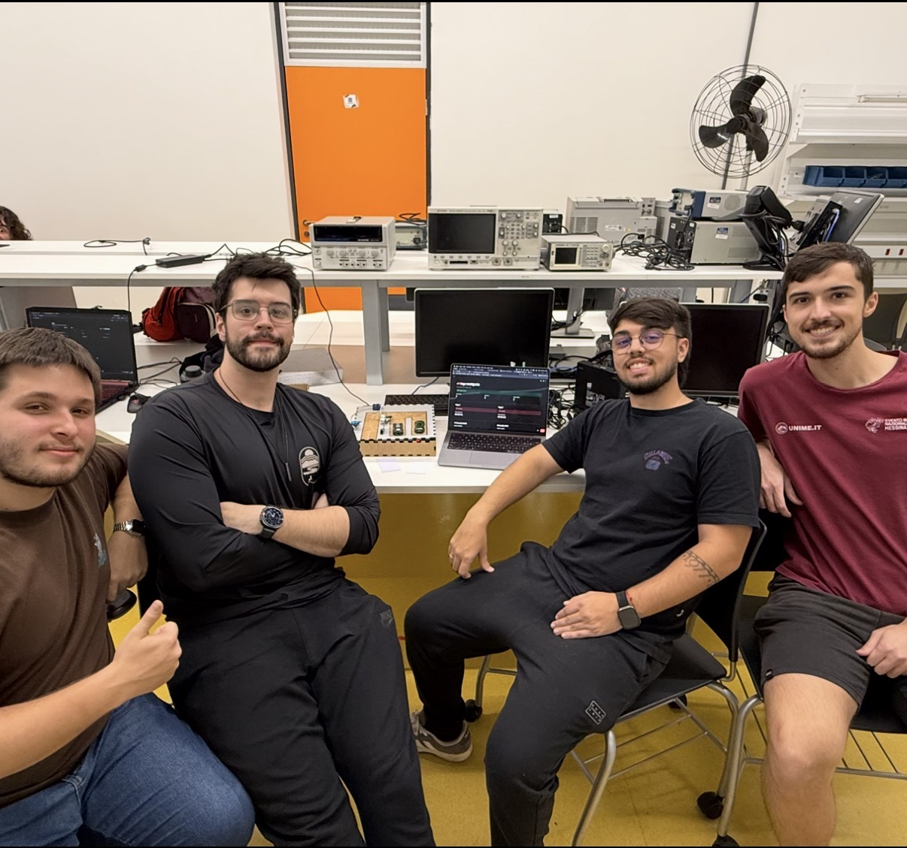

# 🅿️ Vaga Inteligente — Raspberry Pi 4B + Dashboard Online

Sistema de controle de acesso a um estacionamento com **2 vagas**, desenvolvido em **Python** com Raspberry Pi 4B. O usuário se identifica por RFID, o sistema verifica a disponibilidade de vagas, mostra o resultado no display OLED e aciona a cancela via servo motor. Os dados são sincronizados com o **Supabase** e acompanhados em tempo real por um **dashboard online**.

> Parte 1 do projeto (versão com Raspberry Pi Pico): [MLC1202/Projeto_Vagas_Inteligentes](https://github.com/MLC1202/Projeto_Vagas_Inteligentes)

---


## 🌐 Dashboard Online

**[Acessar o dashboard](https://projetovagasinteligentes.streamlit.app/)**

## Foto do Projeto

<!-- Coloque aqui a foto nova do projeto -->

## Vídeo do Projeto

[Link do Vídeo](COLOQUE-O-LINK-AQUI)

## 📋 Sumário

- [Descrição do Problema](#-descrição-do-problema)
- [Funcionalidades](#-funcionalidades)
- [Hardware](#-hardware)
- [Diagrama de Blocos](#️-diagrama-de-blocos)
- [Arquitetura do Software](#️-arquitetura-do-software)
- [Pinagem](#-pinagem-raspberry-pi-4b)
- [Como Rodar](#-como-rodar)
- [Estrutura do Repositório](#-estrutura-do-repositório)
- [Limitações](#️-limitações)
- [Documentação](#-documentação)
- [Equipe](#-equipe)

---

## 🧩 Descrição do Problema

Estacionamentos sem automação exigem funcionários para controle de acesso e não fornecem informação prévia sobre disponibilidade de vagas, causando filas e desperdício de tempo. Este projeto propõe uma solução embarcada de baixo custo para automatizar o controle de entrada, identificação do usuário e direcionamento para vagas disponíveis.

---

## ✅ Funcionalidades

- Leitura de cartão RFID e consulta dos cartões autorizados no banco local (SQLite)
- Detecção de vagas livres/ocupadas via sensores IR
- Display OLED com vagas livres, estado da cancela e, por 5 s após cada cartão, `LIBERADO` / `NEGADO` / `LOTADO` com o nome do usuário
- Abertura da cancela com servo motor, pelo cartão RFID ou pelo dashboard (com login)
- Histórico de eventos e tempo de permanência em cada vaga
- Dashboard online em tempo real (Streamlit Cloud + Supabase)
- Sensor ultrassônico HC-SR04 para a segurança da cancela

---

## 🔧 Hardware

| Componente | Função |
|---|---|
| Raspberry Pi 4B | Processamento, API local, banco de dados e sincronização com a nuvem |
| Leitor RFID MFRC522 | Identificação do usuário por cartão/tag |
| Display OLED I2C SSD1306 | Exibição de mensagens ao usuário |
| 2× Sensor de Obstáculo IR | Detecção de ocupação nas vagas |
| Sensor Ultrassônico HC-SR04 | Segurança da cancela |
| Conversor de Nível Lógico | Compatibilidade 5V→3,3V (ECHO do HC-SR04) |
| Servo Motor SG90 | Acionamento mecânico da cancela |
| Fonte 5V separada | Alimentação do servo (terra comum com o Pi) |
| Protoboard + Jumpers | Montagem do circuito |

---

## 🗂️ Diagrama de Blocos

<!-- Coloque aqui o diagrama de blocos novo -->

---

## 🏗️ Arquitetura do Software

```
Raspberry Pi 4B                                        Nuvem
┌───────────────────────────────────────┐
│ sensores_ir · leitor_rfid · servo      │
│              ▼                         │
│   api.py (FastAPI :8000) + SQLite      │
│      ▲                 ▲               │
│ display_oled.py   sincronizador.py ────┼──▶ Supabase ◀── dashboard.py
└───────────────────────────────────────┘                (Streamlit Cloud)
```

- O **sincronizador** lê a API local e envia ao Supabase o que mudou, com um sinal de vida a cada 10 s. Se a internet cair, sensores e cancela continuam funcionando.
- **Cancela pelo dashboard:** o usuário logado cria um comando no Supabase; o Pi o busca a cada 1,5 s e o executa com as mesmas travas da API local. Comandos com mais de 20 s expiram, para que um clique antigo não mova a cancela quando o Pi voltar a ficar online.
- O dashboard usa só a chave **pública** do Supabase; a chave secreta fica apenas no Raspberry.

---

## 📌 Pinagem (Raspberry Pi 4B)

### Display OLED SSD1306 (I2C, endereço 0x3C)
| Pino OLED | GPIO (BCM) | Pino físico |
|---|---|---|
| VCC | 3V3 | 1 |
| GND | GND | 6 |
| SDA | GPIO2 | 3 |
| SCL | GPIO3 | 5 |

### Leitor RFID MFRC522 (SPI0)
| Pino MFRC522 | GPIO (BCM) | Pino físico |
|---|---|---|
| SDA/SS | GPIO8 (CE0) | 24 |
| SCK | GPIO11 | 23 |
| MOSI | GPIO10 | 19 |
| MISO | GPIO9 | 21 |
| RST | GPIO25 | 22 |
| 3.3V | 3V3 | 17 |
| GND | GND | 20 |

### HC-SR04 (Ultrassônico — Cancela)
| Pino HC-SR04 | Conexão |
|---|---|
| VCC | 5V (pino 2) |
| GND | GND |
| TRIG | GPIO23 (pino 16) |
| ECHO | Conversor de nível → GPIO24 (pino 18) |

> ⚠️ O ECHO do HC-SR04 retorna 5V. **Não conectar diretamente ao Raspberry.** Use o conversor de nível lógico.

### Servo SG90 (Cancela)
| Fio | Conexão |
|---|---|
| Marrom/Preto | GND (comum com o Pi) |
| Vermelho | 5V da fonte separada |
| Laranja/Amarelo | GPIO18 (pino 12) |

### Sensores de Obstáculo IR (Vagas)
| Sensor | GPIO (BCM) | Pino físico |
|---|---|---|
| Vaga 1 | GPIO17 | 11 |
| Vaga 2 | GPIO27 | 13 |

> Nível LOW = vaga ocupada.

---

## 🚀 Como Rodar

### Pré-requisitos
- Raspberry Pi 4B com Raspberry Pi OS
- SPI e I2C habilitados em `sudo raspi-config` → **Interface Options**
- Projeto no Supabase com as tabelas de [`supabase/schema.sql`](supabase/schema.sql)

### Instalação no Raspberry
Com este repositório clonado no Pi, a partir da raiz dele:

```bash
sudo apt update
sudo apt install -y python3-venv python3-lgpio python3-gpiozero python3-spidev
mkdir -p ~/vaga-inteligente
cp raspberry/*.py ~/vaga-inteligente/
cp raspberry/.env.supabase.example ~/vaga-inteligente/.env.supabase   # preencher URL + chave secreta
python3 -m venv --system-site-packages ~/vaga-inteligente/venv
~/vaga-inteligente/venv/bin/pip install -r raspberry/requirements.txt luma.oled
```

### Serviços (iniciam no boot)
```bash
sudo cp raspberry/systemd/*.service /etc/systemd/system/
sudo systemctl daemon-reload
sudo systemctl enable --now vaga-api vaga-dashboard vaga-sync vaga-display
```

### Cadastrar cartão
```bash
cd ~/vaga-inteligente && source venv/bin/activate
python cadastrar_cartao.py 123456789 "Nome do usuário"
python cadastrar_cartao.py 123456789 "Nome do usuário" --negar   # bloqueia o cartão
```

### Testar no PC, sem o Raspberry
```bash
pip install streamlit requests
python simulador.py                    # terminal 1: API falsa em 127.0.0.1:8000
python raspberry/sincronizador.py      # terminal 2: mesma ponte que roda no Pi
streamlit run dashboard.py             # terminal 3: dashboard em localhost:8501
```

### Testes
```bash
cd raspberry
python3 -m unittest discover -s tests
```

---

## 📁 Estrutura do Repositório

```
vaga-inteligente-cloud/
├── README.md
├── dashboard.py                 # Dashboard online (Streamlit Cloud + Supabase)
├── simulador.py                 # API falsa para testar o dashboard sem o Pi
├── requirements.txt             # Dependências do dashboard online
├── supabase/
│   └── schema.sql               # Tabelas e permissões do Supabase
└── raspberry/
    ├── api.py                   # API local (FastAPI, porta 8000)
    ├── banco.py                 # SQLite: vagas, eventos, permanências e cartões
    ├── controlador.py           # Regras da cancela
    ├── servo_cancela.py         # Servo SG90
    ├── leitor_rfid.py           # Leitor RFID MFRC522
    ├── sensores_ir.py           # Sensores IR das vagas
    ├── sensor_ultrassonico.py   # HC-SR04
    ├── seguranca_cancela.py     # Travas de segurança da cancela
    ├── display_oled.py          # Display OLED
    ├── sincronizador.py         # Ponte entre a API local e o Supabase
    ├── dashboard_local.py       # Dashboard na rede local (porta 8501)
    ├── cadastrar_cartao.py      # Cadastro de cartões RFID
    ├── calibrar_cancela.py      # Calibração do servo
    ├── teste_*.py               # Testes manuais de cada componente
    ├── systemd/                 # Serviços que iniciam no boot
    ├── scripts/                 # Atualização e diagnóstico do Pi
    └── tests/                   # Testes automatizados (sem hardware)
```

---

## ⚠️ Limitações

- O SG90 não tem feedback de posição: o sistema informa a posição **comandada**, não a confirmação de que a haste chegou ao destino.

---

## 📄 Documentação

- Requisitos, análise de custos e diagrama de blocos da parte 1: [Projeto_Vagas_Inteligentes/docs](https://github.com/MLC1202/Projeto_Vagas_Inteligentes/tree/main/docs)

---

## 👥 Equipe

- Matheus Antonio da Luz Cardoso — 22.01059-9
- Igor Gava Rubinato — 22.00094-0
- Jornas Fernando da Silva Eboli Machado — 22.00910-8
- Fernando Godoi Grinevicius — 22.00832-2


